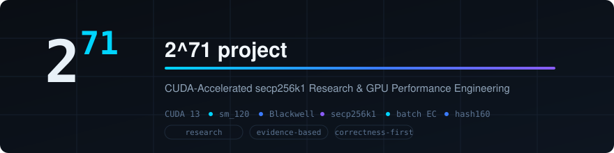
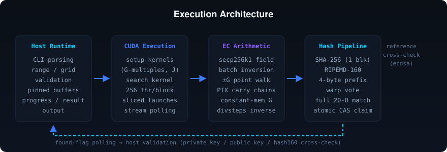
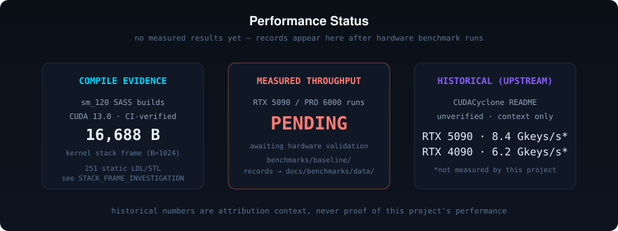

<p align="center">
  
</p>

# 2^71 project

**CUDA-Accelerated secp256k1 Research & GPU Performance Engineering**

[](https://github.com/algomanlife/2-71-project/actions/workflows/ci.yml)


> GPU solver for secp256k1 discrete-logarithm search problems (Bitcoin
> "Satoshi puzzles"), engineered with an evidence-first performance
> methodology: every optimization is gated on correctness tests and
> measured benchmarks, never on assumptions.

---

## Overview

**2^71 project** searches a power-of-two scalar range for the secp256k1
private key whose P2PKH address matches a given target. The entire search
runs on NVIDIA GPUs:

- One CUDA kernel computes elliptic-curve points with a
  **single modular inversion per batch** (batch-inversion stride walk),
  hashes each candidate public key (SHA-256 → RIPEMD-160 = `hash160`),
  and short-circuits on a 4-byte prefix match before the full compare.
- The host sizes the grid from device properties, manages sliced kernel
  launches on a dedicated stream, and validates any hit before printing.
- Build supports CUDA 12.8+ and CUDA 13.x with native Blackwell
  (`sm_120`) SASS plus PTX fallback.

**Status:** pre-release research project. Compilation is verified for
CUDA 13 / `sm_120` in CI; **runtime validation and all performance
measurements on RTX 5090 / RTX PRO 6000 are pending hardware access**
(see [Performance](#performance--benchmarks)).

The project is an independent continuation of Dookoo2's CUDACyclone with
secp256k1 math derived from JeanLucPons/VanitySearch (GPL-3.0) and
FixedPaul/VanitySearch-Bitcrack (AGPL-3.0) — see
[Attribution](#attribution--license).

## Key Features

**Implemented:**

- CUDA secp256k1 field arithmetic with inline-PTX 64-bit carry chains
- Batch inversion: one divsteps-based modular inverse per batch
- ±G symmetric point walk with warp-level early exit
- Single-block SHA-256 and RIPEMD-160 GPU pipeline (register-only)
- Runtime grid configuration (`--grid`, `--slices`) with VRAM-aware sizing
- CUDA 13 build support, `sm_120` SASS + PTX fallback, legacy `sm_75/86/89`
- CPU reference test suite (RIPEMD-160/SHA-256/hash160/base58/secp256k1)
- GPU correctness suite + end-to-end key-skip harness (`proof.py`)
- Reproducible benchmark harness with environment capture and JSON records
- CI quality gates (CUDA 13 container build, tests, hygiene)
- ptxas register reports and sm_120 SASS census via CI

**Planned** (see [roadmap](docs/research/MAXIMUM_PERFORMANCE_ROADMAP.md)):

- Nsight Compute profiling on Blackwell hardware
- Evidence-gated hot-kernel optimization program
- Per-GPU tuned default launch configurations

## Architecture

<p align="center">
  
</p>

| Layer | What it does | Source |
|---|---|---|
| Host runtime | CLI, range/grid validation, pinned host buffers, launch loop, result output | `project_2_71.cu` |
| CUDA execution | one-time setup kernels (G multiples, J = B·G), sliced search launches, non-blocking stream | `project_2_71.cu` |
| EC arithmetic | secp256k1 field ops, batch inversion, ±G walk, divsteps `_ModInv` | `CUDAMath.h` |
| Hash pipeline | 33-byte SHA-256 block → 32-byte RIPEMD-160 block, prefix prefilter, warp vote | `CUDAHash.cu` |
| Validation | found-flag atomic CAS, host-side result formatting; tests cross-check against `ecdsa` reference | `project_2_71.cu`, `tests/` |

Each search thread owns a base point and processes `B` keys per batch:
the kernel computes prefix products of `(G_i − x)`, performs **one**
modular inversion, then derives each candidate point by multiplication —
the classic Montgomery batch-inversion trade of inversions for
multiplications.

## Hardware Compatibility

| GPU | Arch | Compilation | Runtime verification | Benchmarks |
|---|---|---|---|---|
| RTX 5090 | `sm_120` | ✅ CI (CUDA 13.0, SASS+PTX) | ⬜ pending | ⬜ pending |
| RTX PRO 6000 Blackwell | `sm_120` | ✅ CI (CUDA 13.0, SASS+PTX) | ⬜ pending | ⬜ pending |
| RTX 40xx / 30xx (Ada, Ampere) | `sm_89/86` | ✅ CI | ⬜ not run by this project | ⬜ pending |
| RTX 20xx (Turing) | `sm_75` | ✅ CI | ⬜ not run by this project | ⬜ pending |
| pre-Turing (Maxwell/Pascal/Volta) | < `sm_75` | ❌ unsupported by CUDA 13 | — | — |

Both primary GPUs are `sm_120` but not identical: RTX 5090 = 170 SM / 32 GB,
RTX PRO 6000 Blackwell = 240 SM / 96 GB. The application auto-sizes from
device properties, but optimal `--grid/--slices` must be measured per GPU.

## Installation & Build

**Requirements:** CUDA Toolkit 12.8+ (13.x recommended) with `nvcc` on
`PATH`; NVIDIA driver R570+ for Blackwell hardware, R580+ for CUDA 13.x
runtime (verify with `nvidia-smi`); Linux x86_64 (or WSL2 with a
Windows-side driver); GNU make.

```bash
git clone https://github.com/algomanlife/2-71-project.git
cd 2-71-project
make                 # prints toolkit, detected GPU, arch list, full flags
make ptxas-info      # optional: per-kernel register/spill report
```

Reproducible or GPU-less builds:

```bash
make GPU_ARCH=120 SM_ARCHS="120"              # pin to sm_120 only
make GPU_ARCH=                                # skip GPU detection
make NVCC_EXTRA="-DMAX_BATCH_SIZE=512"        # compile-time experiments
```

**Verification:** CI compiles sm_120 + legacy architectures on every push
in the CUDA 13 container. `./project-2-71` with no arguments prints usage
to stderr and exits non-zero.

**Troubleshooting:**

- `nvcc: command not found` — install the CUDA toolkit and ensure
  `nvcc` is on `PATH`, or set `CUDA_HOME`.
- `Unsupported architecture` — old toolkit: sm_120 requires CUDA ≥ 12.8.
- No GPU on the build machine — expected; `make` still compiles (pass
  `GPU_ARCH=` to silence detection).
- Runtime `CUDA init error` — driver issue; check `nvidia-smi` shows the
  GPU and a sufficient driver version.

## Usage

```text
project-2-71 --range <start_hex>:<end_hex> (--address <base58> | --target-hash160 <hex>)
             [--grid A,B] [--slices N]
```

| Flag | Meaning | Constraints |
|---|---|---|
| `--range` | scalar search range, hex `start:end` | length must be a power of two; `start` aligned to the length |
| `--address` | P2PKH target address (base58) | mutually exclusive with `--target-hash160` |
| `--target-hash160` | target hash160, 40 hex chars | mutually exclusive with `--address` |
| `--grid` | `A,B` = points-per-batch × batches-per-SM | A: even power of two ≤ 1024; range must be divisible by A |
| `--slices` | batches per thread per kernel launch | 1 … 2^20 |

Example (known-answer vector from the original project):

```bash
./project-2-71 --range 2000000000:3FFFFFFFFF \
               --address 1HBtApAFA9B2YZw3G2YKSMCtb3dVnjuNe2 \
               --grid 512,256
```

Output: startup banner with GPU info (device, SM count, threads, memory),
then per-second progress lines
`Time: … | Speed: … Mkeys/s | Count: … | Progress: … %`, and on a match:

```text
======== FOUND MATCH! =================================
Private Key   : 00000000000000000000000000000000000000000000000000000022382FACD0
Public Key    : 03C060E1E3771CBECCB38E119C2414702F3F5181A89652538851D2E3886BDD70C6
```

Exit codes: `0` match found; `130` interrupted (Ctrl+C, finishes the
current slice); non-zero on invalid arguments or CUDA errors.

Common errors: `range length must be a power of two`, `start must be
aligned to the range length`, `provide either --address or
--target-hash160, not both` — all from argument validation before any GPU
work.

## Performance & Benchmarks

<p align="center">
  
</p>

### A. Historical upstream benchmarks (CUDACyclone, unverified context)

| GPU | Grid | Throughput | Source |
|---|---|---|---|
| RTX 5090 | 128,256 | ~8.4 Gkeys/s | CUDACyclone README example |
| RTX 4090 | 128,1024 | 6214 Mkeys/s | community report |
| RTX 4060 | 512,512 | 1238 Mkeys/s | original author's report |

These numbers predate this project, were produced with unknown
toolchain/driver state, and are retained **only as attribution context**.
They are not evidence about this codebase.

### B. Current verified benchmarks

**None yet.** No run has been executed on target hardware by this project.

### C. Pending hardware validation

| Test | GPU | Deliverable |
|---|---|---|
| Correctness suite + `proof.py` | RTX 5090, RTX PRO 6000 | pass/fail in issue tracker |
| First baseline records (`benchmarks/baseline/run_baseline.sh`) | both | `docs/benchmarks/data/*.json` + BASELINE_RESULTS table |
| Grid/slices sweep (A5) | both | per-GPU optimal configuration |
| Nsight Compute profile (E1) | both | local-memory/stall evidence for O-05 decision |

Recorded results will always include GPU model, CUDA version, commit
hash, configuration, throughput, correctness status, measurement date,
and a link to the JSON record. Charts appear only when backed by measured
data.

## Performance Engineering

Ongoing program — [full roadmap](docs/research/MAXIMUM_PERFORMANCE_ROADMAP.md):

- **[Stack-frame investigation](docs/research/STACK_FRAME_INVESTIGATION.md)** —
  the hot kernel's 16,688 B local frame is fully attributed
  (`subp[]` = 16·B bytes; CI-measured SASS census); whether it limits
  runtime throughput is decided by experiments E1–E4 on hardware.
- **Correctness-first optimization** — every `opt/*` PR carries the full
  test suite and a benchmark plan; regressions are recorded, not hidden.
- **[Performance history](docs/benchmarks/PERFORMANCE_HISTORY.md)** —
  cumulative measured tracking with per-GPU baselines.
- **Compile-time evidence** — CI emits ptxas register reports and sm_120
  SASS dumps on every change (kernel-resource-matrix job, artifacts
  retained 90 days).

## Testing & Validation

| Layer | Status | Where |
|---|---|---|
| CPU reference tests (RIPEMD-160/SHA-256 official vectors, hash160, base58, secp256k1 vs `ecdsa`) | ✅ pass (CI + local) | `tests/test_reference.py` |
| Pure-python RIPEMD-160 reference | ✅ validated vs official vectors + hashlib | `tests/reference_ripenmd160.py` |
| GPU correctness suite (known-answer, CPU↔GPU consistency, boundaries, no-skip/duplicate, repeatability) | ⬜ **pending hardware** (skips visibly without GPU) | `tests/test_gpu_validation.py` |
| End-to-end key-skip harness | ⬜ **pending hardware** | `proof.py` |
| CUDA 13 / sm_120 compilation | ✅ CI green | `.github/workflows/ci.yml` |
| SASS resource census | ✅ CI | kernel-resource-matrix job |

```bash
pip install ecdsa
python3 -m unittest discover -s tests -v   # CPU suite runs anywhere
python3 proof.py --range 200000000:3FFFFFFFF --grid 512,512   # needs GPU
```

A skip is never reported as a pass; CPU CI is never presented as GPU
validation.

## Development Roadmap

| Phase | Scope | Status |
|---|---|---|
| 1 | Repository migration & rebranding | ✅ complete |
| 2 | CUDA 13 modernization & validation infrastructure | ✅ complete (PRs #7–#12) |
| 3 | Foundational optimization & performance research | 🔄 in progress (stack-frame investigation, dead-code removal, roadmap v2) |
| 4 | Hardware benchmarking & architecture-specific tuning | ⬜ pending RTX 5090 / PRO 6000 access |
| 5 | Advanced performance optimization (evidence-gated) | ⬜ gated on Phase 4 |

## Documentation

| Document | Content |
|---|---|
| [Technical audit](docs/audits/INITIAL_TECHNICAL_AUDIT.md) | execution flow, kernel analysis, hypotheses, sm_120 compile evidence |
| [Stack-frame investigation](docs/research/STACK_FRAME_INVESTIGATION.md) | 16,688 B frame attribution, SASS census, experiments E1–E4 |
| [CUDA 13 compatibility](docs/compatibility/CUDA13_BLACKWELL.md) | toolchain matrix, drivers, reproducible build |
| [Optimization roadmap](docs/research/MAXIMUM_PERFORMANCE_ROADMAP.md) | evidence-gated proposal table |
| [Baseline results](docs/benchmarks/BASELINE_RESULTS.md) | methodology + status (pending) |
| [Performance history](docs/benchmarks/PERFORMANCE_HISTORY.md) | cumulative measured tracking |
| [Benchmark harness](benchmarks/baseline/README.md) | how to run + record format |
| [Attribution](ATTRIBUTION.md) | provenance & licensing audit |

## Contributing

- **Branches:** `audit/*`, `cuda13/*`, `opt/*`, `test/*`, `benchmark/*`,
  `ci/*`, `docs/*` — one concern per branch.
- **PRs:** objective, current implementation, proposed change, files,
  rationale, correctness results, benchmark comparison, limitations,
  rollback instructions (9 sections).
- **Correctness is a merge gate:** CPU suite green always; GPU suite +
  `proof.py` green for any hot-path change where hardware allows;
  compile-only changes state that explicitly.
- **Performance claims need records:** measured via
  `benchmarks/baseline/run_baseline.sh`, referenced in
  `PERFORMANCE_HISTORY.md`.
- **Style:** match existing code (no reformatting churn); keep diffs
  minimal and reviewable; never push to `main` directly.

## Attribution & License

2^71 project is an independent continuation of
[CUDACyclone](https://github.com/Dookoo2/CUDACyclone) by Dookoo2
(redistribution authorized by the author). secp256k1 math derives from
[JeanLucPons/VanitySearch](https://github.com/JeanLucPons/VanitySearch)
(GPL-3.0) and [FixedPaul/VanitySearch-Bitcrack](https://github.com/FixedPaul)
(AGPL-3.0) with major CUDA modifications. Full audit:
[ATTRIBUTION.md](ATTRIBUTION.md). The repository carries no license file
yet — a GPL-3.0-compatible decision is tracked in the issue tracker.
