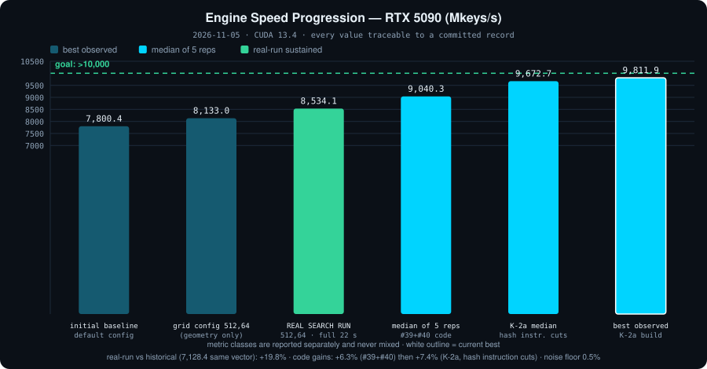
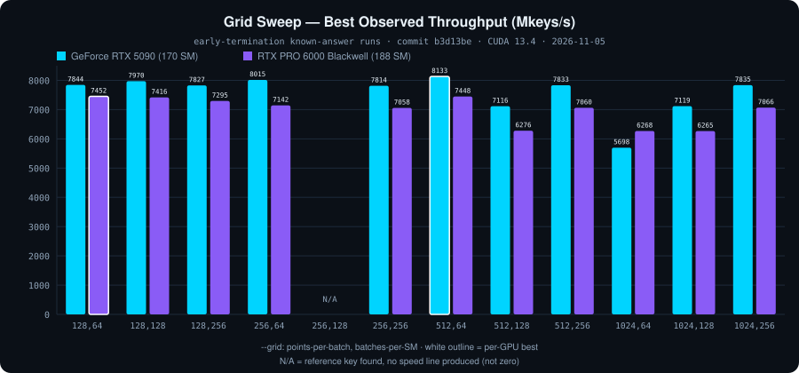
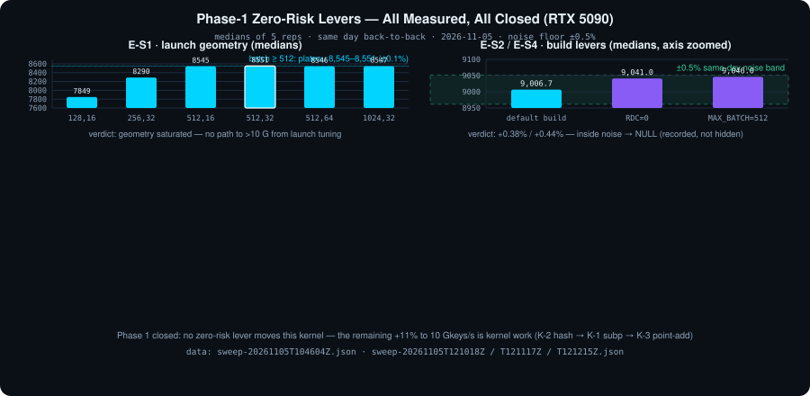
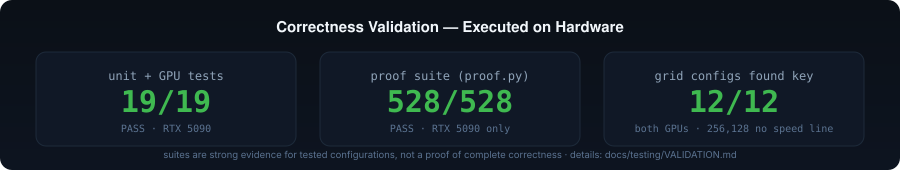
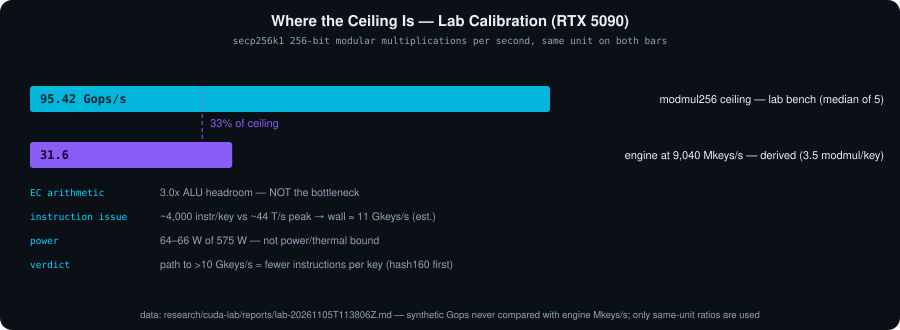

<p align="center">
  
</p>

# 2^71 Project

**CUDA GPU Computing and Performance Benchmarking**

[](https://github.com/algomanlife/2-71-project/actions/workflows/ci.yml)


GPU solver for secp256k1 discrete-logarithm search problems (Bitcoin
"Satoshi puzzles"), built as a **measured, evidence-first CUDA
performance engineering project**: NVIDIA Blackwell support, CUDA 13.4
toolchain, C++17, Linux; correctness-validated test suites on real
hardware; reproducible benchmarking infrastructure; and an
optimization program gated on profiling evidence rather than
assumptions.

Independent continuation of Dookoo2's CUDACyclone; secp256k1 math
derived from VanitySearch (GPL-3.0) / VanitySearch-Bitcrack (AGPL-3.0)
— see [Attribution & License](#16-attribution--license).

---

## 1. Overview

**2^71 Project** searches a power-of-two scalar range for the secp256k1
private key whose P2PKH address matches a given target:

- One CUDA kernel performs elliptic-curve point walks with a **single
  modular inversion per batch** (Montgomery batch-inversion stride),
  hashes each candidate public key (SHA-256 → RIPEMD-160 = `hash160`),
  and short-circuits on a 4-byte prefix match.
- The host sizes the grid from device properties, runs sliced kernel
  launches on a dedicated stream, and validates hits before reporting.
- All CUDA API calls are error-checked; outcomes carry distinct exit
  codes (FOUND / NOT_FOUND / INTERRUPTED / ERROR).

**State:** hardware-validated correctness on RTX 5090; first measured
grid-sweep benchmarks on both Blackwell GPUs published; profiling-driven
optimization program in progress.

## 2. Features

- CUDA secp256k1 field arithmetic (inline-PTX 64-bit carry chains)
- Batch inversion with divsteps-based modular inverse
- ±G symmetric point walk, warp-level early exit
- Single-block SHA-256 + RIPEMD-160 GPU pipeline (register-only)
- Runtime grid configuration (`--grid`, `--slices`), VRAM-aware sizing,
  partial-block small-range support
- CUDA 13.x build, `sm_120` SASS + PTX fallback, legacy `sm_75/86/89`
- Verified exit codes and CUDA error reporting (error name + description)
- CPU reference test suite + GPU correctness suite + 528-test proof
  harness
- Reproducible benchmark infrastructure (JSON records, medians,
  telemetry) and CI quality gates

## 3. Supported GPUs

| GPU | Arch | Compilation | Runtime verification | Benchmarks |
|---|---|---|---|---|
| RTX 5090 | `sm_120` | ✅ | ✅ tests + proof suite + 12/12 grids | ✅ published |
| RTX PRO 6000 Blackwell WE | `sm_120` | ✅ | ✅ 12/12 grid configs | ✅ published |
| Ada / Ampere (`sm_89/86`) | | ✅ | not run by this project | — |
| Turing (`sm_75`) | | ✅ | not run by this project | — |
| pre-Turing | < `sm_75` | ❌ CUDA 13 minimum | — | — |

Compilation support ≠ tested compatibility; runtime rows above reflect
actually executed validation.

## 4. Quick Start (fresh server → verified search)

```bash
# 1) Clone and set up (creates .venv with the ecdsa oracle dependency)
git clone https://github.com/algomanlife/2-71-project.git
cd 2-71-project
bash scripts/setup.sh            # one command: venv + deps + build

# 2) Correctness gates (33 tests; GPU required for the hardware suite)
source .venv/bin/activate
python3 -m unittest discover -s tests -v

# 3) Run a search (known-answer structure — use your own range/target)
./project-2-71 --range <start_hex>:<end_hex> \
               --address <your_target_p2pkh_address> \
               --grid 512,64
# exit 0 = FOUND (banner + private key) · 1 = exhaustive · 130 = Ctrl+C · 2 = CUDA error

# 4) Measure speed the reproducible way (medians of 5, records + telemetry)
bash benchmarks/sweep/grid_sweep.sh --repeat 5 --grids "512,64"

# 5) Standalone research lab (synthetic CUDA benchmarks, correctness-gated)
cd research/cuda-lab
cmake -B build -DCMAKE_CUDA_ARCHITECTURES=120 && cmake --build build -j
./build/cuda-lab-tests && ./build/cuda-lab-bench --bench all --verify-only
```

If `Error: invalid P2PKH address` appears, the pasted address is not
byte-identical to the real one (invisible characters) — verify
`echo -n '<address>' | wc -c` prints 34; see TROUBLESHOOTING.md.

## 4. Build Requirements

- CUDA Toolkit 12.8+ (13.x recommended; sweep measured on 13.4)
- NVIDIA driver: R570+ for Blackwell, R580+ for CUDA 13 runtime
  (5090 test rig: driver 615.71.09)
- Linux x86_64 (Ubuntu 24.04 validated), GNU make, C++17 host compiler

## 5. Installation

```bash
git clone https://github.com/algomanlife/2-71-project.git
cd 2-71-project
make                 # prints toolkit, GPU, arch list, full flags
make ptxas-info      # optional: per-kernel register/spill report
```

Reproducible / variant builds:

```bash
make GPU_ARCH=120 SM_ARCHS="120"     # sm_120 only
make RDC=0                           # whole-program device code (EXP-01)
make NVCC_EXTRA="-DMAX_BATCH_SIZE=512"
```

## 6. Usage

```text
project-2-71 --range <start_hex>:<end_hex> (--address <base58> | --target-hash160 <hex>)
             [--grid A,B] [--slices N]
```

| Flag | Meaning | Constraints |
|---|---|---|
| `--range` | hex scalar range `start:end` | power-of-two length, start aligned to length |
| `--address` | P2PKH target address | exclusive with `--target-hash160` |
| `--target-hash160` | 40 hex chars | exclusive with `--address` |
| `--grid` | `A,B` = points-per-batch × batches-per-SM | A even power of two ≤ 1024, divides range |
| `--slices` | batches per thread per launch | 1 … 2^20 |
| `--device` | pin to one GPU index | default: ALL GPUs share the range (multi-GPU) |

Example (structure — substitute your own range and target):

```bash
./project-2-71 --range <start_hex>:<end_hex> \
               --address <your_target_p2pkh_address> \
               --grid 512,64 --slices 16
```

A ready-to-run correctness example using the repository's public test
vector lives in the test suite (`tests/test_gpu_validation.py`,
`TestKnownAnswer`); the benchmark methodology documents the same
canonical vector. Full CLI reference with every constraint and error
message: [docs/USAGE.md](docs/USAGE.md).

Exit codes: `0` FOUND · `1` exhaustive NOT_FOUND or invalid arguments
(`Error:` on stderr) · `130` interrupted (Ctrl+C) · `2` CUDA/runtime
error (name + description on stderr).

## 7. GPU Performance

<p align="center">
  
</p>

**Current measured — RTX 5090** (2026-11-05, CUDA 13.4, early-termination
known-answer runs, medians of 5 reps):

| | RTX 5090 (170 SM) | RTX PRO 6000 Blackwell (188 SM) |
|---|---:|---:|
| Median of 5 reps | **9,720.6 Mkeys/s** (`512,64`, K-2a+K-2b2) | — |
| Best observed | 9,832.5 Mkeys/s (`512,64`, K-2a+K-2b2) | **7,452.4 Mkeys/s** (`128,64`) |
| Initial baseline (best observed) | 7,800.4 Mkeys/s | 7,074.8 Mkeys/s |
| 12/12 grids found reference key | ✅ | ✅ |

**Real search runs** (manual rig invocation, `--grid 512,64`, full-run
averages, reference key found): the **sustained speed is not stable on
this rig** — observed between **8.5 and 9 Gkeys/s** (8,534.1 pre-K-2a
and 8,767.1 post-K-2a on the second historical vector,
[log](docs/benchmarks/data/execution-log-2026-11-05d.txt); the third
vector fluctuates in the same band). Root cause: cloud-GPU clock
behavior in longer runs (no clock lock available) — the sweep's
short-run best-observed medians (~9.6) are a separate metric class,
always reported separately and never mixed
([PERFORMANCE_HISTORY](docs/benchmarks/PERFORMANCE_HISTORY.md)).
Cumulative sustained vs the historical default-config log (7,128.4):
**~+23%**; accept/reject decisions use same-day sweep medians only.

**First kernel-level optimization accepted (K-2a, 2026-11-05):** SHA-256
round constants folded into instruction immediates + single-instruction
RIPEMD rotations → **+7.4% measured** (median 9,672.7 vs 9,006.7
same-day baseline, >14× the noise floor); the worst K-2a run beats
every prior median. Record:
[data/sweep-20261105T133135Z.json](docs/benchmarks/data/sweep-20261105T133135Z.json).

Do not infer universal GPU ranking from this single series; see the
methodology and limitations in
[GRID_RESULTS.md](docs/benchmarks/GRID_RESULTS.md).

## 8. Grid Benchmark Results & Phase-1 Verdicts

<p align="center">
  
</p>

Full table with interpretation rules:
[GRID_RESULTS.md](docs/benchmarks/GRID_RESULTS.md) · machine-readable:
[data/grid-sweep-2026-11-05.json](docs/benchmarks/data/grid-sweep-2026-11-05.json)

Highlights: per-GPU optima differ (`512,64` vs `128,64`); `512,128`
dips on both GPUs; `256,128` found the key but produced no speed line
(recorded missing, not zero).

**Phase-1 engine-speed experiments (RTX 5090, medians of 5 reps each):**

<p align="center">
  
</p>

| Experiment | Median | Verdict |
|---|---:|---|
| E-S1 launch geometry (6 grids) | best 8,551.2 (`512,32`) | geometry saturated — plateau ±0.1% for batch ≥ 512 |
| E-S2 `RDC=0` vs default build | 9,041.0 vs 9,006.7 | **null** (+0.38%, inside ±0.5% noise) |
| E-S4 `MAX_BATCH_SIZE=512` | 9,046.0 | **null** (+0.44%, inside noise) |

Verdicts are recorded with their numbers in
[PERFORMANCE_HISTORY.md](docs/benchmarks/PERFORMANCE_HISTORY.md);
records in [data/](docs/benchmarks/data/) (sweep-20261105T*.json).
Same-binary reproducibility 0.09%; same-day noise floor ~0.5% (no
clock lock on the rig — medians compensate).

## 9. Correctness Validation

<p align="center">
  
</p>

| Suite | Result | Where |
|---|---|---|
| Unit + GPU tests | **33 tests**: 15 CPU (run anywhere) + 18 GPU-required | `tests/` |
| Proof suite (no-skip key coverage) | **528/528 PASS** (RTX 5090 only) | `proof.py` |
| Grid configs found reference key | **12/12** on both GPUs | sweep runs |
| Median sweep workflow (RTX 5090) | **60/60 valid runs**, all found the reference key | [data/](docs/benchmarks/data/) |
| Real search runs | historical + 2026-11-05c logs, reference keys found | [data/](docs/benchmarks/data/) |
| Lab correctness (synthetic benches) | 9/9 bit-for-bit vs host references | `research/cuda-lab` |

These are strong evidence for the tested configurations — not "547
independent proofs of complete correctness". The 528-test proof run is
evidenced on RTX 5090 only. Details and scope rules:
[VALIDATION.md](docs/testing/VALIDATION.md).

**Address gotcha (rig terminals):** `Error: invalid P2PKH address`
means the pasted/typed string is not byte-identical to the address
(invisible characters, or `l`/`1` and `O`/`0` confusion) — the engine
itself is fine (sweep runs with the same address succeed). Verify with
`echo -n '<address>' | wc -c` (must print 34), or extract a known-good
address:
`--address "$(grep -oP 'ADDRESS="\K[^"]+' benchmarks/sweep/grid_sweep.sh | tr -d '[:space:]')"`.

```bash
python3 -m unittest discover -s tests -v          # CPU suite runs anywhere
python3 proof.py --range 200000000:3FFFFFFFF --grid 512,512   # GPU
```

## 10. Benchmark Methodology

- **Two grades of measurement, never mixed:**
  - *Grid sweep (both GPUs)*: early-termination known-answer searches
    (2^37-key range), 12 grid configs, best-observed speed per run —
    single runs, not medians.
  - *Median sweep workflow (RTX 5090, executed)*:
    `benchmarks/sweep/grid_sweep.sh --repeat 5` — medians with variance,
    power telemetry (dmon 1 Hz), raw run logs retained, failed runs
    recorded with exit codes and excluded from statistics.
- **Noise discipline (measured on the rig, no clock lock available):**
  same-binary drift 0.09%, same-day noise floor ~0.5%, cross-day drift
  ~5% — accept/reject decisions use same-day medians only.
- **Provenance:** every record carries commit, GPU, driver, CUDA
  version, and (since `19ffaf6`) `.build-flags` — the actual nvcc/rdc
  flags of the swept binary.
- **Honesty rules:** missing speed lines are recorded as missing, never
  zero; lab synthetic Gops are never compared with engine Mkeys/s.
- Benchmark records live in `docs/benchmarks/data/` and are tracked
  cumulatively in [PERFORMANCE_HISTORY.md](docs/benchmarks/PERFORMANCE_HISTORY.md);
  `benchmarks/profile/ncu_profile.sh` is ready for the Nsight Compute
  metric set (blocked by `ERR_NVGPUCTRPERM` on the current rig).

## 11. Architecture

Host runtime → CUDA execution → elliptic-curve arithmetic → hash
processing → result validation:

<p align="center">
  
</p>

Full pipeline reference with per-kernel resource data:
[CUDA_PIPELINE.md](docs/architecture/CUDA_PIPELINE.md)

Each search thread owns a base point and processes `B` keys per batch:
prefix products of `(G_i − x)`, one modular inversion, then candidate
points by multiplication — the classic batch-inversion trade of
inversions for multiplications.

## 12. Performance Engineering

**Lab calibration — where the ceiling is (RTX 5090, measured):**

<p align="center">
  
</p>

**Multi-GPU (2× RTX 5090):** [setup & test runbook](docs/MULTI_GPU_SETUP.md) —
one range, all GPUs, aggregated ~2x throughput.

**User & reference documentation:**
[Usage (CLI reference)](docs/USAGE.md) ·
[Search workflow](docs/SEARCH_WORKFLOW.md) ·
[Proof & validation](docs/PROOF_AND_VALIDATION.md) ·
[Troubleshooting](docs/TROUBLESHOOTING.md)

- **[Engine speed program (top priority)](docs/optimization/ENGINE_SPEED_PROGRAM.md)** —
  measured path toward >10 Gkeys/s on the RTX 5090. **Phase 1 closed**
  (all zero-risk levers measured null); current: **9,672.7 Mkeys/s
  median** after K-2a (+7.4%, accepted); real-run sustained 8,534
  Mkeys/s; next: K-2b (RIPEMD round scheduling) → K-1 subp segmentation
  → K-3 point-add restructure (~3.4% median left to the 10 Gkeys/s goal).
- [Stack-frame investigation](docs/research/STACK_FRAME_INVESTIGATION.md) —
  the 16.7 KB kernel frame is fully attributed (`subp[]` = 16·B); grid
  `1024,*` performing comparably to `128,*` shows frame size alone does
  not determine throughput (now confirmed by E-S4: halving the frame is
  speed-neutral).
- [Performance baseline & bottleneck classification](docs/optimization/PERFORMANCE_BASELINE.md)
- [Optimization experiment log](docs/optimization/EXPERIMENTS.md) —
  one mechanism per experiment, medians with variance, keep-or-revert
  decisions; EXP-01 (rdc A/B) prepared.
- [Maximum-performance roadmap](docs/research/MAXIMUM_PERFORMANCE_ROADMAP.md) —
  evidence-gated proposals O-01…O-09.
- [Technical audit](docs/audits/INITIAL_TECHNICAL_AUDIT.md) — execution
  flow, hypotheses H1–H9, compile evidence.
- [Blackwell performance research](docs/research/BLACKWELL_PERFORMANCE.md) —
  documented facts vs measured vs hypotheses, with sources.
- [CUDA research lab](research/cuda-lab/README.md) — standalone synthetic
  benchmarks (precise op definitions) + automated experiment runner.
- [secp256k1 comparison](docs/research/SECP256K1_COMPARISON.md) —
  UltrafastSecp256k1 (MIT, verified) evaluation protocol.
- [Search discrepancy investigation](docs/research/SEARCH_DISCREPANCY_INVESTIGATION.md) —
  grid-config traversal order vs progress accounting (Phase 4).
- [Bottleneck analysis](docs/research/BLACKWELL_BOTTLENECKS.md) —
  evidence inventory; counter profiling blocked by `ERR_NVGPUCTRPERM`.
- [Optimization results](docs/research/OPTIMIZATION_RESULTS.md) —
  measured-only record (currently empty by design).

## 13. Known Limitations

- RTX 5090 results now include medians-of-5 and a sustained real-run;
  the RTX PRO 6000 series is still best-observed single runs only.
- No clock lock available on the benchmark rig — noise is handled by
  same-day median pairs (0.09% same-binary, ~0.5% same-day), not
  eliminated.
- RTX PRO 6000: driver version not recorded; full test/proof suites not
  run on it (grid sweep only).
- Nsight Compute profiling blocked by `ERR_NVGPUCTRPERM` on the rig —
  bottleneck classification rests on lab calibration + A/B builds.
- The lab `ec-scalar-mul` number is pending re-measurement with the
  fixed bench (zero-scalar erratum, 2026-11-05).
- No LICENSE file yet (GPL-3.0-compatible decision open) — see
  attribution.

## 14. Development Roadmap

| Phase | Scope | Status |
|---|---|---|
| 1 | Migration & rebranding | ✅ |
| 2 | CUDA 13 modernization + validation infrastructure | ✅ |
| 3 | Foundational optimization & performance research | ✅ |
| 4 | Hardware validation & benchmarking | ✅ medians, real-run, lab calibration published |
| 5 | Engine speed >10 Gkeys/s program | 🔄 K-2a accepted (+7.4% → 9,672.7 median); K-2b/K-1 next |

## 15. Changelog

See [CHANGELOG.md](CHANGELOG.md) — verified entries only, with PR
references.

## 16. Attribution & License

2^71 Project is an independent continuation of
[CUDACyclone](https://github.com/Dookoo2/CUDACyclone) by Dookoo2
(redistribution authorized by the author). secp256k1 math derives from
[JeanLucPons/VanitySearch](https://github.com/JeanLucPons/VanitySearch)
(GPL-3.0) and [FixedPaul/VanitySearch-Bitcrack](https://github.com/FixedPaul)
(AGPL-3.0) with major CUDA modifications. No license file exists yet; a
GPL-3.0-compatible decision is tracked in the issue tracker. Full audit:
[ATTRIBUTION.md](ATTRIBUTION.md).
